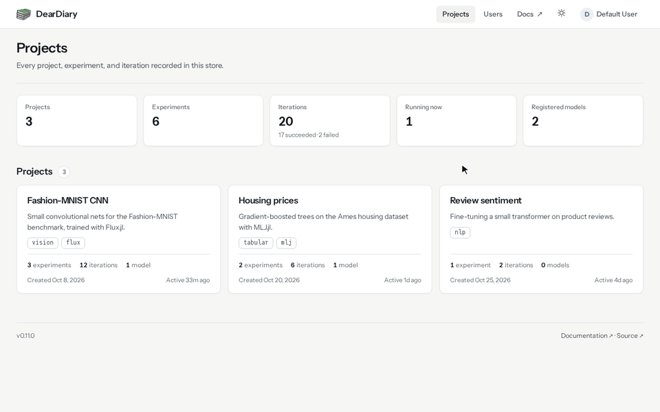

<p align="center">
  
</p>

<h1 align="center">DearDiary.jl</h1>

<p align="center">
  A diary for your machine learning experiments, written in Julia.
</p>

<p align="center">
  <a href="https://github.com/JuliaAI/DearDiary.jl/actions/workflows/CI.yml"></a>
  <a href="https://codecov.io/github/JuliaAI/DearDiary.jl"></a>
  <a href="https://github.com/JuliaTesting/Aqua.jl"></a>
  <a href="https://juliaai.github.io/DearDiary.jl/dev/"></a>
</p>

<p align="center">
  
</p>

DearDiary records what you train: the parameters you chose, the metrics you got, the files
you saved, and the exact Julia environment each run used. By default everything lives in one DuckDB
file, so you can start on a laptop with no server at all. When more people join, the same
calls log to a shared server over HTTP, and everyone browses the results in the built-in
web dashboard.

## Install

```julia
using Pkg
Pkg.add("DearDiary")
```

Or type `]add DearDiary` in the REPL. DearDiary needs Julia 1.10 or later.

## Log your first run

```julia
using DearDiary
DearDiary.initialize_database()

project_id, _ = create_project("Iris classification")
experiment_id, _ = create_experiment(project_id, DearDiary.IN_PROGRESS, "Decision-tree sweep")

with_iteration(experiment_id) do iter
    create_parameter(iter.id, "max_depth", 7)
    create_metric(iter.id, "accuracy", 0.96)
end
```

`with_iteration` opens a run, executes your code, and closes the run for you. A clean
return marks it `SUCCEEDED`. If your code throws, the run is marked `FAILED` and keeps the
error text. Either way, DearDiary saves a snapshot of the active environment so you can
rebuild it later.

To look around, start the server and open <http://127.0.0.1:9001>:

```julia
DearDiary.run()
```

## A quick tour

The screenshots below come from a small demo store: a learning-rate sweep for a
Fashion-MNIST classifier, a gradient-boosting search, and a model registry with a version
in production.

### Compare runs at a glance


Each experiment lists its iterations with one column per parameter and one per final
metric. Trials from a sweep sit under the run that launched them. Click a header to sort,
or type in the filter box to narrow the rows.

### See every metric over time

<picture>
  <source media="(prefers-color-scheme: dark)" srcset="docs/src/assets/screenshots/experiment-charts-dark.png" />
  
</picture>

Hover a chart to read each run's value at that step. Click a legend entry to hide a run,
or click a line to open it. Here the diverged run (`learning_rate = 0.01`) is easy to spot.

### Rebuild any run's environment


A run's snapshot holds the Julia version, the git commit, the entrypoint, and the full
`Project.toml` and `Manifest.toml`. `DearDiary.restore(iteration_id)` writes them to a
fresh directory, ready for `Pkg.instantiate`.

### Keep a model registry


Register a checkpoint as a model version, linked to the iteration that trained it and the
artifact that holds its bytes. Move versions through staging and production. Promoting a
new version to production archives the previous one.

### Edit right on the page


Names, descriptions, notes, statuses, stages, and tags can all be changed in place. When
an action is blocked, the menu says why. In this screenshot the experiment can't be deleted
while a model version still points at one of its runs.

### Share it with your team


Turn on authentication and administrators can create accounts and grant read, create,
update, and delete access project by project.

### Store artifacts where you like

Artifact bytes can sit inside the database, on a local filesystem, or in any
S3-compatible store such as AWS S3, MinIO, or Cloudflare R2. `migrate_artifacts!` moves
existing artifacts between backends while the database stays live.

## Why DearDiary?

Reproducible ML depends on knowing which code, data, and environment produced each
result. Established trackers such as MLflow, Weights & Biases, and Aim are Python-first,
and Python environment capture usually records dependency specifications that the
installer resolves again at install time. DearDiary is written for Julia and saves the
`Manifest.toml` of every run, so `DearDiary.restore(iteration_id)` can bring back the same
dependency tree later. The tracking API is the same whether the store is a single DuckDB
file on a laptop or a multi-worker deployment backed by S3.

## Learn more

The [documentation](https://juliaai.github.io/DearDiary.jl/dev/) starts with a
[quickstart](https://juliaai.github.io/DearDiary.jl/dev/getting-started/quickstart/) and
has guides for:

- [logging from a remote client](https://juliaai.github.io/DearDiary.jl/dev/guides/remote-client/)
- [the model registry](https://juliaai.github.io/DearDiary.jl/dev/guides/model-registry/)
- [parent and child iterations](https://juliaai.github.io/DearDiary.jl/dev/guides/child-iterations/) for sweeps and distributed workers
- storing artifacts on a [filesystem](https://juliaai.github.io/DearDiary.jl/dev/guides/filesystem-artifacts/) or on [S3](https://juliaai.github.io/DearDiary.jl/dev/guides/s3-artifacts/)
- [reproducing a past run](https://juliaai.github.io/DearDiary.jl/dev/guides/reproduce-a-run/)
- [the web dashboard](https://juliaai.github.io/DearDiary.jl/dev/server/web-ui/)

## Contributing

Bug reports, questions, and pull requests are welcome on the
[GitHub repository](https://github.com/JuliaAI/DearDiary.jl). Please follow
[BlueStyle](https://github.com/JuliaDiff/BlueStyle) and add tests for new features.
[CONTRIBUTING.md](CONTRIBUTING.md) walks through the setup.
