# Embedded web UI

!!! warning "Experimental"
    The dashboard's URL paths, DOM structure, and CSS class names can change without a
    deprecation cycle. Treat it as a browsing convenience and do not script against its
    HTML.

DearDiary serves a dashboard next to the REST API. Every page is rendered on the server
from the same service layer the API uses, so a page shows exactly what the store holds at
the moment it loads. The pages are plain HTML with an inlined stylesheet and a small
script. The fonts ship with the package, so the dashboard makes no requests to
third-party hosts.

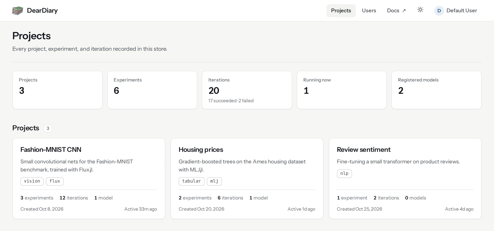

## Configuration

The UI starts by default. Three env vars control it:

```text
DEARDIARY_ENABLE_UI=true        # set to false to skip booting the UI server
DEARDIARY_UI_HOST=127.0.0.1     # bind address
DEARDIARY_UI_PORT=9001          # port the dashboard listens on
```

`DearDiary.run(; env_file=".env")` boots the REST API and the dashboard on their
respective ports. `DearDiary.stop()` closes both servers together.

## Pages

Each entity has its own URL, so you can bookmark a page, share it, or open it from a
training log.

| Path | What it shows |
|:-----|:--------------|
| `/` | The projects the viewer can read, with totals for experiments, iterations, and registered models across the workspace. |
| `/project/<id>` | The project's experiments (status, iteration count, an outcome bar of succeeded, failed, running, and killed iterations, last activity, tags) and its model registry. |
| `/experiment/<id>` | An iterations table with one column per parameter and per final metric value, child iterations listed under their parent; one chart per metric key comparing iterations; and the experiment's artifacts with download links. |
| `/iteration/<id>` | A tile per metric with its latest value and a sparkline, a step chart per metric series, the parameters, notes and captured error text, lineage (parent and children), model versions registered from the iteration, and the environment snapshot (a child without one shows its nearest ancestor's): Julia version, git commit, entrypoint, and the recorded `Project.toml` and `Manifest.toml` with a ready-to-paste `restore` call. |
| `/model/<id>` | The model's versions with stage, source iteration, and artifact. |
| `/resource/<id>/download` | The artifact bytes as a file download. |

A project page shows its experiments with an outcome bar for each, followed by the
project's models:

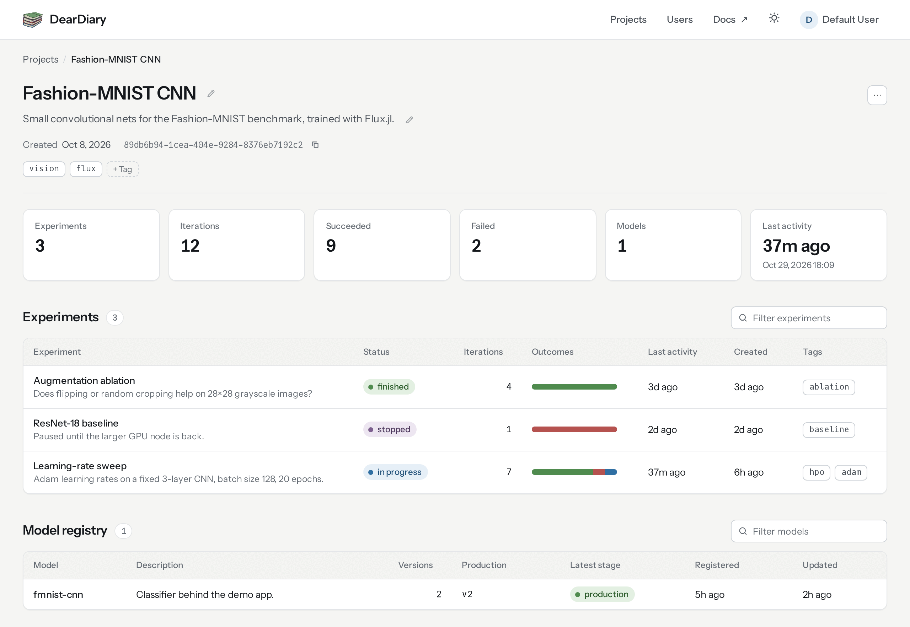

An experiment page puts every iteration in one table. Trials from a sweep sit under the
driver run that launched them:

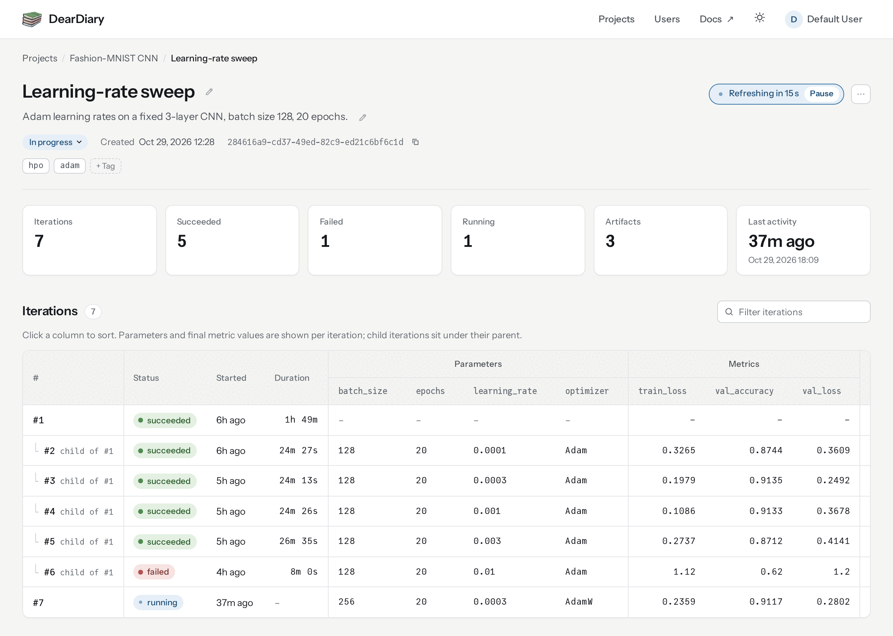

Below the table, one chart per metric key compares the iterations:

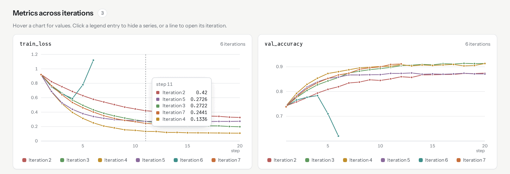

An iteration page starts with its notes and a tile per metric, then plots each metric
series by step:

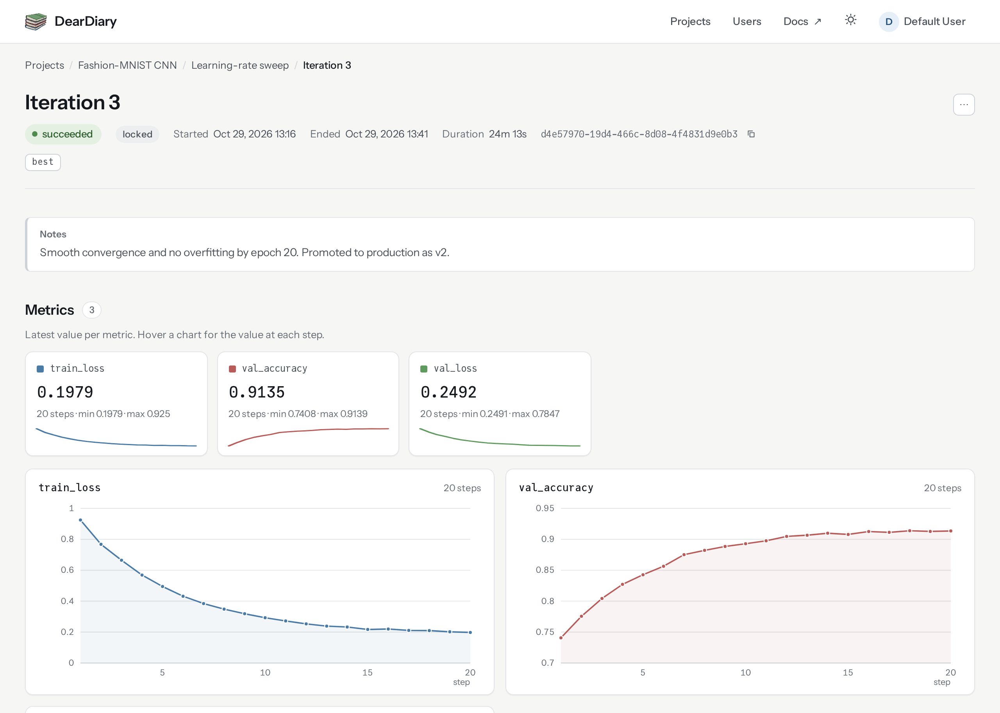

Further down, the environment section shows what [`restore`](@ref) will rebuild:

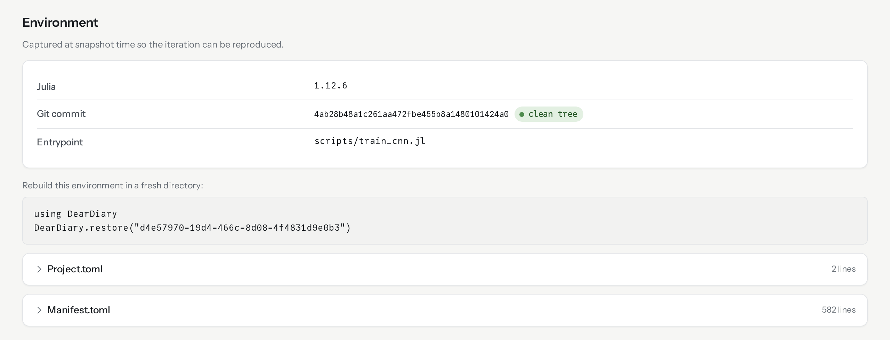

A model page lists its versions with their stage, source iteration, and artifact:

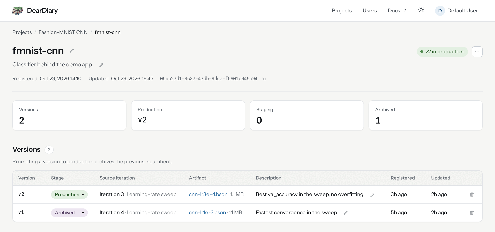

Tables sort when you click a column header, and the filter box above a table narrows its
rows as you type. Charts show the value of every series at the hovered step. Clicking a
legend entry hides that series, and on the experiment page clicking a line opens its
iteration. A page that contains a running iteration reloads every 15 seconds; the pill in
the page header pauses that.

The dashboard follows the operating system's colour scheme. The toggle in the top bar
overrides it, and the browser remembers the choice.

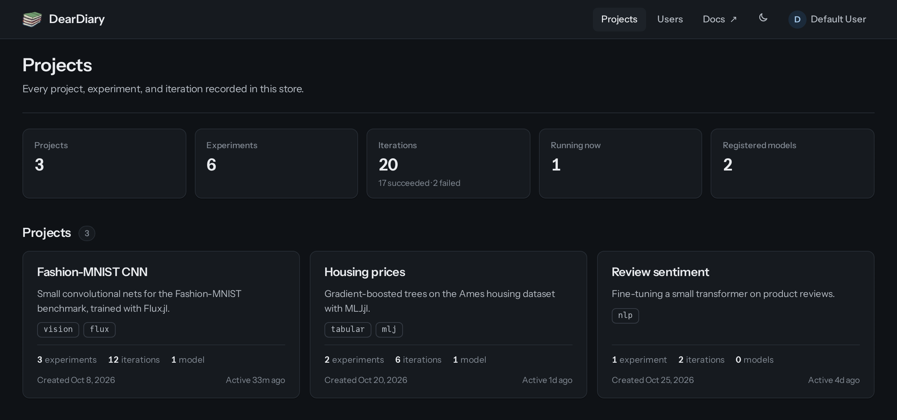

Every control works from the keyboard. Tab reaches each editor, menu, and sortable column
header, Enter saves an inline edit, and Escape cancels it or closes the actions menu. Text
keeps at least the 4.5:1 contrast of WCAG AA in both themes, and the layout works from
phone width up without horizontal scrolling. Wide tables scroll on their own.

## Editing records

You edit records in place, the way issue trackers and notebooks work. A pencil next to the
name, description, or notes swaps the text for a small form (Enter saves, Escape cancels).
The status or stage badge is a menu that applies on change; from the keyboard, an
**Apply** button appears instead. A dashed **+ Tag** chip adds a tag. Lifecycle and
destructive actions live in the **⋯** menu at the top right of the page.

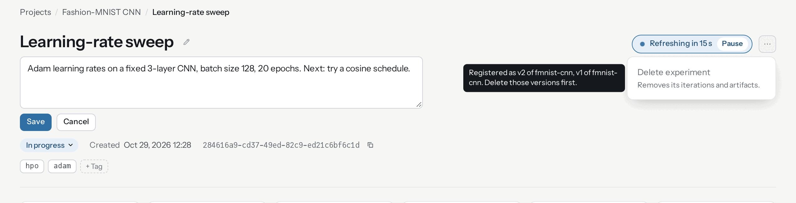

Controls appear only when the viewer holds the matching permission. An action that exists
but is unavailable right now (killing an iteration that has ended, deleting an iteration a
model version still points at) stays visible in the menu but inert, with the reason in a
tooltip. Everything a run recorded about itself stays read-only.

| Record | Edited in place | Actions menu | Required permission |
|:-------|:----------------|:-------------|:--------------------|
| Project | Name, description, tags | Delete | Administrator |
| Experiment | Name, description, status, tags | Delete | Update; create for tags; delete |
| Iteration | Notes and tags, while it is running | Kill a running iteration; delete | Update; create for tags; delete |
| Model | Name, description | Delete | Update; delete |
| Model version | Stage and description, in the versions table | Delete | Update; delete |

Finishing or stopping an experiment records its end time, and reopening it clears the
time. Parameters, metrics, artifacts, environment snapshots, timestamps, and ids cannot be
changed from the dashboard, and an iteration that has ended is locked, just as it is in
the API. Deletes cascade and are blocked by the registry exactly as described in
[Deleting records](@ref); a blocked delete shows which versions hold the record.

## Signing in

With `DEARDIARY_ENABLE_AUTH=false` (the default) every page renders as the seeded `default`
administrator and no sign-in is shown. With authentication enabled, the dashboard asks for
the same username and password the REST API accepts at `POST /auth`, then keeps the issued
token in a cookie that expires with the token (see [Authentication](@ref)). Visiting any
page without a valid session redirects to `/login`, and the **Sign out** button in the top
bar ends the session.

Members see the projects they hold read permission on. Administrators see everything.

## Users and settings

| Path | Who | What it does |
|:-----|:----|:-------------|
| `/settings` | Everyone | Edit your first and last name and change your password. |
| `/users` | Administrators | List every account with its role and project access; create accounts, optionally as administrators. |
| `/users/<id>` | Administrators | Edit an account: profile, password, role, per-project read, create, update, and delete permissions, and deletion. |

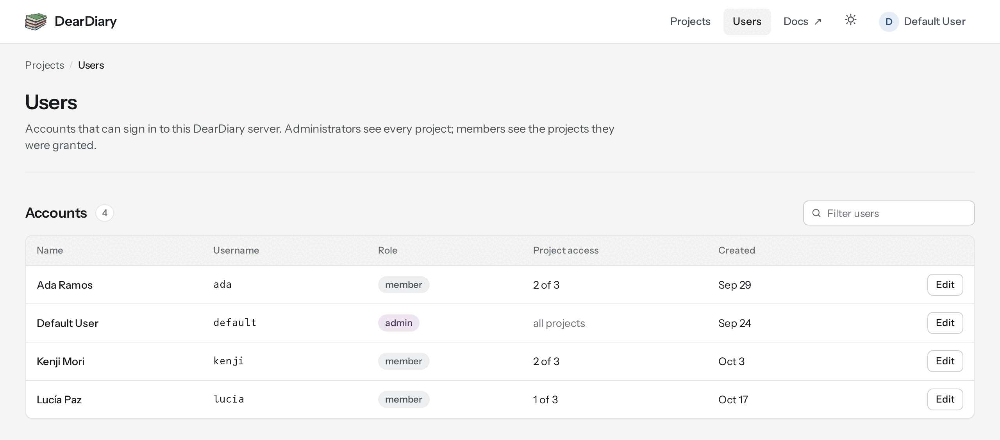

On an account's page, each project gets its own row of permissions:

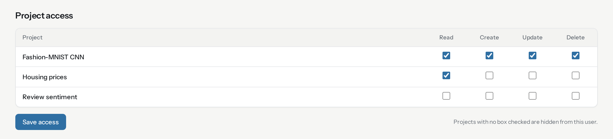

The same rules as the REST API apply. Only administrators change roles, you cannot change
your own role or delete your own account, and the seeded `default` account cannot be
deleted or demoted. Every form carries a per-session token and is accepted only from the
dashboard's own origin.

## Disabling the UI

Set `DEARDIARY_ENABLE_UI=false` in the env file. The REST API on `DEARDIARY_PORT` keeps
running unchanged. This suits a headless CI runner or a container image that needs no
browser-facing surface.

## Known limitations

- Only an administrator creates accounts, on `/users` or through the REST API. There is no
  self-service sign-up.
- Logging happens elsewhere. New projects, experiments, iterations, parameters, metrics,
  artifacts, and registry entries come from the REST API or the Julia client. The
  dashboard edits what is listed under [Editing records](@ref) and nothing else.
- Pages with running iterations reload on a timer rather than receiving pushed updates.
- The experiment page plots the 40 most recent iterations per metric so large sweeps stay
  readable. The table still lists every iteration.
